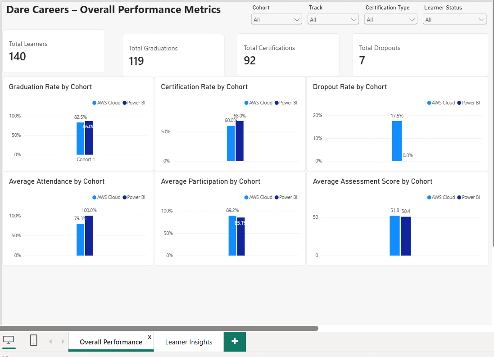
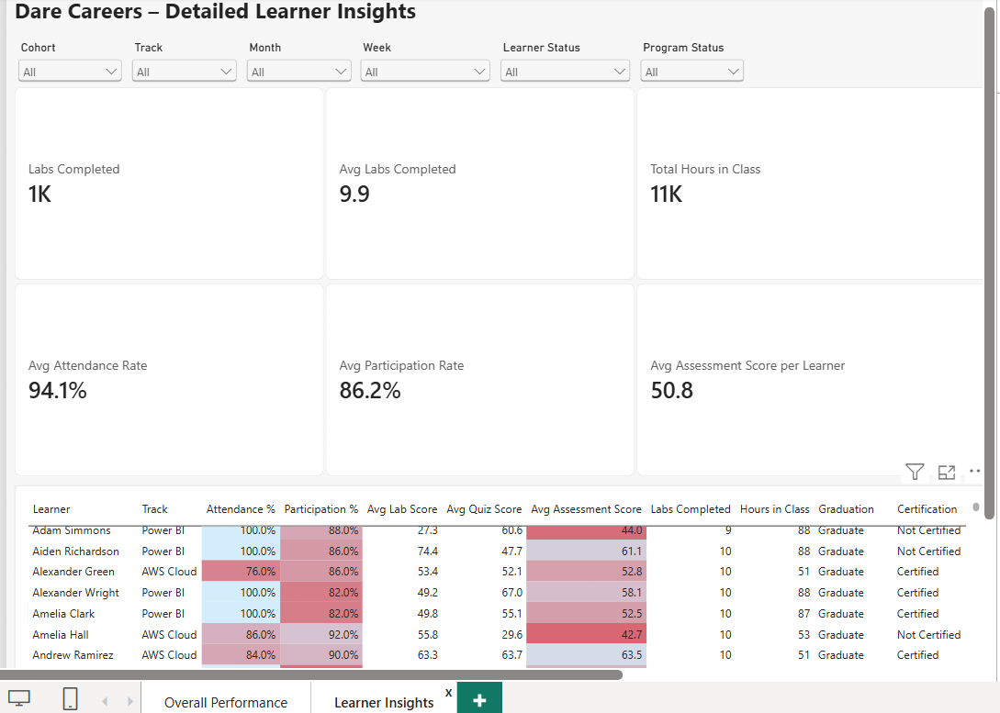

# Dare Careers – Learner Progress & Performance Dashboard

A Power BI dashboard that tracks attendance, participation, assessment scores and outcomes
(graduation, certification and dropout) for learners in Dare Careers' **Power BI** and **AWS Cloud**
training tracks.

It helps program managers and trainers follow engagement over the 10-week program, compare tracks
and cohorts, and spot at-risk learners.

---

## Dashboard

### Page 1 – Overall Performance Metrics
High-level view of learner outcomes for program stakeholders.



| Element | Content |
|---|---|
| Cards | Total Learners, Total Graduations, Total Certifications, Total Dropouts |
| Bar charts (by cohort, split by track) | Graduation Rate, Certification Rate, Dropout Rate, Average Attendance, Average Participation, Average Assessment Score |
| Slicers | Cohort, Track, Certification Type, Learner Status |

### Page 2 – Detailed Learner Insights
Learner-level view for trainers and program managers.



| Element | Content |
|---|---|
| Cards | Count of Labs, Average Labs Completed, Total Hours Spent in Class, Average Attendance Rate, Average Participation Rate, Average Assessment Score |
| Learner table | Learner, Track, Attendance %, Participation %, Avg Lab Score, Avg Quiz Score, Avg Assessment Score, Labs Completed, Hours in Class, Graduation, Certification |
| Highlighting | Red-to-green colour scale on attendance, participation and assessment score to flag at-risk learners |
| Slicers | Cohort, Track, Month, Week, Learner Status, Program Status |

---

## Key findings (Cohort 1)

| Metric | AWS Cloud | Power BI | Overall |
|---|---|---|---|
| Learners | 40 | 100 | **140** |
| Graduation rate | 82.5% | 86.0% | **85.0%** (119) |
| Certification rate | 60.0% | 68.0% | **65.7%** (92) |
| Dropout rate | 17.5% | 0.0% | **5.0%** (7) |
| Average attendance | 79.3% | 100.0% | **94.1%** |
| Average participation | 89.2% | 85.1% | **86.2%** |
| Average assessment score | 51.8 | 50.4 | **50.8** |

- All 7 dropouts are in the **AWS Cloud** track. Every AWS learner missed at least one session under the
  30-minute rule, while every Power BI learner attended all 50 sessions.
- AWS Cloud learners participate more and score slightly higher, but attend less of the class time.
- Assessment scores average around 50/100 in both tracks, which suggests labs and quizzes are a
  difficulty point worth reviewing.

---

## Data

Four data sources per track, in one cohort:

| Source | Format | Content |
|---|---|---|
| Zoom Attendance | CSV per class day, in Week 1–10 folders | Name, Email, Join/Leave time, Duration, Role |
| Labs & Quizzes | Excel, one sheet each for Labs and Quizzes | Weekly scores per learner (Week 1–10) |
| Participation | Excel | Per day, a comma-separated list of participant names |
| Status of Learners | Excel | Graduation and certification status per learner |

The source data is **not included** in this repository. To run the report, place it in this structure:

```
data/
└── Cohort 1/
    ├── Cloud Training/
    │   ├── Labs & Quizes/
    │   ├── Participation/
    │   ├── Status of Learners/
    │   └── Zoom Attendance/Week 1 … Week 10/
    └── PowerBI Training/
        └── (same structure)
```

New cohorts are added by creating another folder (for example `data/Cohort 2/`) with the same layout
and refreshing the report. No query changes are needed.

---

## Data preparation (Power Query)

All queries are in [`power-query/`](power-query/).

| Query | What it does |
|---|---|
| `DataFolderPath` | Parameter holding the path to the `data` folder |
| `Attendance` | Combines all Zoom CSVs; reads cohort, track, week and date from folder and file names; converts both duration formats to minutes; applies the 30-minute rule |
| `Assessments` | Reads the Labs and Quizzes sheets, unpivots Week 1–10, flags completed assessments, dates each week to its last class day |
| `Participation` | Splits each day's name list into one row per learner and matches names to emails |
| `Status` | Reads graduation and certification status and adds certification type (load disabled) |
| `Learners` | One row per learner: status, attendance summary, truncated attendance, dropout flag, program status |

Data issues found and handled:
- Zoom duration is `h:mm:ss` in Power BI files but plain minutes in AWS files.
- Participation lists learners by name, not email (all names matched to emails).
- Source file and column names differ between tracks.

---

## Data model

Star schema with three filter tables and three fact tables.

```
              Learners (1)         Date (1)          Weeks (1)
                 │  Email             │ Date             │ Week
     ┌───────────┼───────────┐   ┌────┼────┐       ┌─────┼─────┐
     ▼           ▼           ▼   ▼    ▼    ▼       ▼     ▼     ▼
 Attendance  Participation  Assessments  (each fact table has all three relationships)
```

- All relationships are one-to-many with single-direction filtering.
- Slicers use the filter tables only, so every visual is filtered consistently.
- `Date` and `Weeks` are calculated tables built from the data, so they grow with new cohorts.
- All measures are stored in a `_Measures` table.

---

## Business rules

Full details: [`docs/business-rules.md`](docs/business-rules.md).

- **Attended**: a learner attended a session only if they spent **more than 30 minutes** in Zoom.
  This applies to every attendance figure on both pages.
- **Completed lab/quiz**: score greater than 0.
- **Truncated attendance**: the learner did not attend every class session (Days Attended < Class Days).
- **Dropout**: Non Graduate **and** Not Certified **and** Truncated attendance, all three at once.
- **Certification type** follows the track: AWS Cloud → AWS, Power BI → Power BI.
- **Program status**: Completed if the track's last class date has passed, otherwise Ongoing.

---

## DAX measures

Full list with formulas: [`docs/dax-measures.md`](docs/dax-measures.md).

| Area | Measures |
|---|---|
| Outcomes | Total Learners, Total Graduations, Total Certifications, Total Dropouts, Graduation Rate, Certification Rate, Dropout Rate |
| Attendance | Class Sessions, Sessions Attended, Attendance Rate, Avg Attendance Rate, Total Hours in Class, Avg Hours per Learner |
| Participation | Participation Days, Participation Rate, Avg Participation Rate |
| Assessments | Avg Assessment Score, Avg Lab Score, Avg Quiz Score, Avg Assessment Score per Learner, Labs Completed, Avg Labs Completed |

"Average per learner" measures use `AVERAGEX ( Learners, … )`, which calculates each learner's value
first and then averages them.

---

## How to run

1. Install **Power BI Desktop** (Windows).
2. Clone this repository and add the data in the `data/` structure shown above.
3. Open the report in [`report/`](report/) with Power BI Desktop.
4. Go to **Transform data → Edit parameters**, set **DataFolderPath** to the full path of your
   `data` folder (ending with `\`), and click **Refresh**.

---

## Repository structure

```
dare-careers-learner-dashboard/
├── docs/
│   ├── business-rules.md      # Rules and assumptions
│   ├── dax-measures.md        # All DAX measures and calculated tables
│   └── data-dictionary.md     # Tables and columns
├── power-query/               # Power Query (M) scripts
├── report/                    # Power BI report
├── screenshots/               # Dashboard screenshots
├── .gitignore                 # Excludes data/ and local Power BI files
└── README.md
```

## Tools

Power BI Desktop · Power Query (M) · DAX · Git & GitHub
